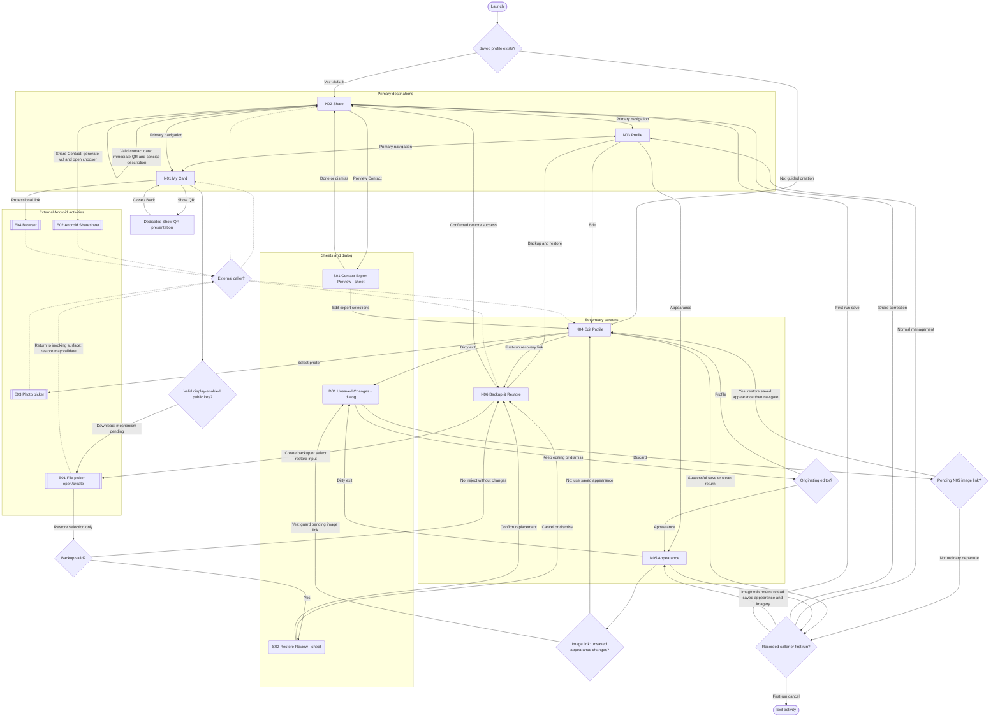

# VCard Native — P0.2 Navigation Map

**Date:** 2026-10-29 · **Status:** APPROVED  
**Approval authority:** Project owner · **Approval date:** October 29, 2026 · **Milestone:** P0.2 APPROVED / COMPLETE.  
Approved UX navigation, including Clarifications A and B; technical dependencies remained unresolved at original approval. P0.3 and implementation were not yet authorized at that time. Read the [specification](P0.2_UX_FLOW_AND_NAVIGATION_DRAFT.md) for state/Back rules and [flows](P0.2_USER_FLOWS.md) for F01–F15. All IDs below are documentation identifiers.

> **Owner-approved Milestone 1.10 refinements (2026-11-01):** First-time setup is Welcome → Basic Information → optional Contact Information → Review → Create My Card, committed only through the existing A2 store; valid restore also bypasses setup. With a saved profile, the primary navigation is exactly **My Card | Share | Profile**, in that order, with Share as the default. The single Version 1.0 card is Primary automatically; no selector is shown. Share presents the export-enabled contact QR, “Scan to save my contact.”, Preview Contact, and Share Contact. Preview is read-only; Share Contact opens Android’s native chooser directly. My Card displays saved, visibility-enabled contact values as readable, selectable rows; it does not offer Call, Message, or Email actions. Show QR opens a dedicated full-screen presentation without changing the selected tab. The Profile hub groups Personalization and Data & Security; its Advanced editor tab links to draft-backed Visibility & Sharing, Security & Encryption, Hosted Profile, and Profile Images. Appearance has a stable layout, live compact theme/accent preview, explicit save, and confirmed discard. Delete Profile requires confirmation and clears the local A2 store without changing its format or deleting external backup files. These requirements supersede conflicting first-run, editor, navigation, Share, Appearance, and deletion notes below for Milestone 1.10; they do not add accounts, cloud storage, online sharing, QR-image export, or multiple profiles.

## Count and legend

**Six app screen destinations:** three primary roots plus three secondary screens. **Two bottom sheets** and **one reusable dialog** are separate transient surfaces, giving nine named internal surfaces in total. Four categories of external Android activity are listed separately. The dedicated My Card QR presentation is a transient full-screen route, not a navigation tab.

| Prefix | Meaning | Count |
|---|---|---|
| N01–N03 | Primary roots | 3 |
| N04–N06 | Secondary screens | 3 |
| S01–S02 | Bottom sheets | 2 |
| D01 | Reusable confirmation dialog | 1 |
| E01–E04 | External Android activity categories, not owned app screens | 4 |
| C-prefixed diagram nodes | Conditional checks, not destinations | Not counted |

## Markdown hierarchy

```text
Launch [conditional saved-profile check]
├── No saved profile → N04 Edit Profile [guided creation mode]
│   ├── Save succeeds → N02 Share
│   ├── Restore backup → N06 Backup & Restore [first-run entry]
│   └── Clean Back / confirmed discard → exit activity
└── Saved profile → primary navigation
    ├── N01 My Card [primary; Show QR opens a dedicated presentation]
    │   ├── Contact values → readable rows; no Call, Message or Email action
    │   └── Valid, display-enabled public key → E01 download destination [conditional]
    ├── N02 Share [primary; center tab and default destination]
    │   ├── Contact QR [immediate valid QR and concise description; no initial gate]
    │   │   ├── Preview Contact → S01 read-only Contact Preview
    │   │   │   └── Edit Sharing Settings → N04 [return to Share]
    │   │   └── Share Contact → E02 Android Sharesheet directly
    └── N03 Profile [primary; management hub]
        ├── N04 Edit Profile [secondary; single editor]
        │   ├── Photos → E03 Android photo picker
        │   ├── Public-key input → supported mechanism pending P0.4/P0.5
        │   ├── Save succeeds → recorded caller (normally N03)
        │   └── Dirty exit → D01 Unsaved Changes [dialog]
        ├── N05 Appearance [secondary]
        │   ├── Clean/explicitly saved appearance: image link → N04 → refreshed N05
        │   ├── Dirty image link → D01: Keep editing/dismiss → N05; Discard → saved appearance → N04
        │   └── Dirty exit → D01 Unsaved Changes [same reusable dialog]
        └── N06 Backup & Restore [secondary]
            ├── Create full backup → E01 create-document picker
            └── Restore → E01 open-document picker
                ├── Invalid input → inline rejection at N06 [no replacement]
                └── Valid input → S02 Restore Review [conditional bottom sheet]
                    ├── Cancel/dismiss → N06 [no changes]
                    └── Confirm → progress at N06 → success → N02
```

## Mermaid flowchart

Rectangular N nodes are app screens, rounded S nodes are bottom sheets, D01 is a dialog and double-bordered E nodes are external activities. Diamond C nodes are conditional checks. Subgraph labels distinguish primary and secondary screens; conditional first-run editor entry, public-key download and validated restore do not add screens.



The file picker is shared by different operations: only a restore-file selection enters backup validation; backups and public-key downloads return to their own callers. E01 also represents a potential public-key file-input handoff if later specifications choose file input; that choice is not finalized. Diagram edges summarize successful routes; busy/error states remain on their caller as described in the specification. External return arrows do not claim that delivery or import succeeded.

## Back, entry context and conditional surfaces

| Surface/context | Return rule |
|---|---|
| Primary root selection | Select existing root; do not stack duplicates |
| Primary roots | Back from Share exits; Back from My Card or Profile selects Share |
| N04/N05 | Actual caller after clean return/save; dirty exit uses D01; no-profile save goes N02, cancel exits |
| N06 | N03, or no-profile N04 when entered from first-run recovery |
| S01/S02 | Dismiss to invoking screen; no export/restore on dismissal |
| D01 | Dismiss/Keep editing retains editor without navigating. Ordinary Discard returns/exits; pending N05 image-link Discard restores saved appearance then opens N04 |
| Restore commit | Brief progress stage on N06; navigation temporarily unavailable; interruption safety remains mandatory |
| External activity | Return to invoker, reconcile result and preserve available draft/mode/focus |

N04's caller is recorded before departure; invoking it from S01 dismisses that sheet and sets return to N02. For N05's image link, D01 Keep editing/dismiss stays at N05; Discard restores previously saved appearance then proceeds to N04. Clean or explicitly saved appearance permits the link without D01; ordinary appearance Save still returns to N03. N04 return to N05 reloads current saved appearance and refreshed saved imagery. Photo-picker cancellation never replaces an existing saved image; no second image editor, automatic save or new dialog is added. Shared screens are reused rather than nested indefinitely.

## Flow coverage against the map

| Flow | Map route |
|---|---|
| F01 | Launch → N04 → N02; optional N06 |
| F02 | N01/N03 → N04 → caller; E03 for photos |
| F03 | My Card displays saved contact details; explicit professional-link selection may open E04 |
| F04 | N01 → N02 contact mode → S01 → E02; presentation remains N02 |
| F05 | N02 web-mode condition → N04 or E02; copy is inline |
| F06 | N02 → S01 → E02; correction via N04 |
| F07 | N02 → S01 for contact mode, then E01/E02; web mode directly E01/E02 |
| F08 | N03 → N05; clean/saved image link → N04 → refreshed N05; dirty link → D01: Keep editing/dismiss → N05, Discard → saved appearance → N04 |
| F09 | N03 → N06 → E01 → N06 |
| F10 | N03 or first-run N04 → N06 → E01 → validation → S02 → N06 → N02 |
| F11 | Inline states at N01/N02/N04/N05/N06; same caller on failure |
| F12 | External return paths or launch saved-state check; no extra recovery screen |
| F13 | N03 or N02/S01 → N04 → caller; fresh N02/S01 review |
| F14 | N04 conditional input; N01 → conditional public-key download → E01 |
| F15 | Primary selection, caller returns, S01/S02 dismissal and D01 guard |

Clarification A: N02 displays the valid offline contact QR immediately. Preview Contact opens a read-only summary; Share Contact generates the .vcf from saved export-enabled values and opens Android's native chooser directly. Contact Export settings remain independent of My Card visibility. No online-sharing or QR-image export controls are exposed.

No Settings, account, Wallet, NFC, cloud-sync, multiple-profile or standalone success/error destination is introduced. Mermaid source has been reviewed for route consistency; rendered output has not been tested.
